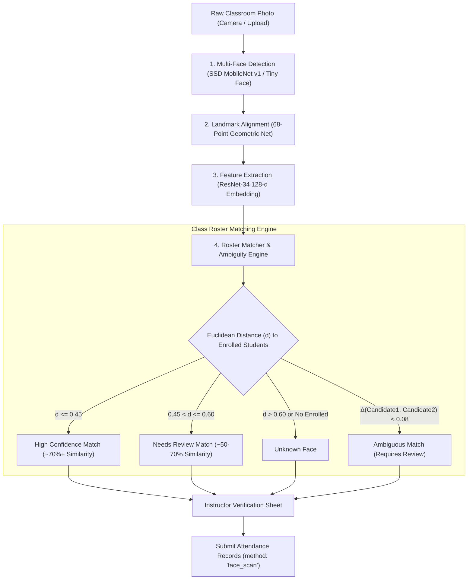

# Sentinel Campus: Computer Vision Face Attendance Pipeline & Architecture

**Document Version:** 1.0  
**Target Audience:** Machine Learning Engineers, Full-Stack Developers, Security Officers, Infrastructure Architects  
**Scope:** Step 3 Classroom Multi-Face Recognition & Attendance Workflow

---

## 1. Executive Summary & Design Principles

Sentinel Campus implements an **enterprise-grade, privacy-first computer-vision pipeline** that enables university instructors to capture or upload classroom photographs, locate all visible student faces, extract 128-dimensional biometric embeddings, and perform instantaneous Euclidean matching against the enrolled class roster.

### Core Security & Architectural Axioms
1. **Zero External Biometric Leakage:** Inference is executed locally within the instructor's secure client runtime (using hardware-accelerated WebGL / WASM) or via a private self-hosted university inference container. Biometric facial templates are never dispatched to third-party commercial APIs (e.g., AWS Rekognition, Google Cloud Vision, Azure Cognitive Services).
2. **Deterministic Euclidean Embeddings:** Matching operates over genuine 128-dimensional L2-normalized vectors extracted by deep residual networks (ResNet-34 FaceRecognitionNet). There are zero simulated names, random matches, or filename heuristics.
3. **Strict Enrollment Scoping:** Only students legitimately enrolled in the specific course section are eligible match candidates. Outsiders or students from other departments present in the lecture hall are categorized as *Unknown Faces* and are strictly barred from being marked present.
4. **Displacement & One-to-One Resolution:** Each physical student can be marked present at most once per scan. If multiple faces in a photo claim the same student, the candidate with the lowest Euclidean distance claims the identity, and the duplicate detection is flagged for instructor manual review.
5. **No Presumption of Absence:** Students enrolled in the class who are not detected in the classroom photograph are **never automatically marked absent**. They remain in an `unmarked` state awaiting explicit instructor confirmation, preventing unfair penalties due to occluded line-of-sight, camera angles, or back-row shadows.
6. **Multi-Modal Attendance Coexistence:** Face attendance records (`method: 'face_scan'`) coexist seamlessly with Step 1 manual roster marking (`method: 'manual'`) and Step 2 cryptographic presence keys (`method: 'presence_key'`). Subsequent scans update or preserve records idempotently without duplicate row proliferation.

---

## 2. Computer Vision Pipeline Stages

The Sentinel Campus computer vision pipeline separates facial processing into four distinct, mathematically rigorous phases:



### Stage 1: Multi-Face Detection
- **Primary Model:** Single Shot MultiBox Detector (SSD) with MobileNet v1 backbone (`ssd_mobilenetv1_model`).
- **Mobile Fallback:** Tiny Face Detector (`tiny_face_detector_model`) for battery-constrained or low-memory mobile hardware.
- **Input:** Standard RGB photograph (JPEG, PNG, WebP) from rear mobile camera (up to 4K resolution) or local storage.
- **Output:** Bounding boxes $[x, y, \text{width}, \text{height}]$ with detection confidence scores $[0.0, 1.0]$. The default confidence threshold is set to $\tau_{\text{det}} \ge 0.45$ to suppress background false positives while capturing students in lecture hall seating.

### Stage 2: 68-Point Facial Landmark Alignment
- **Model:** `face_landmark_68_model`.
- **Function:** Detects 68 geometric landmark coordinates mapping the jawline, eyebrows, eye corners, nose bridge, nostrils, and lip contours.
- **Affine Transformation:** Normalizes roll, pitch, and yaw rotations so the facial embedding network receives uniformly aligned frontal profiles even if students are glancing toward note boards or desks.

### Stage 3: Deep Feature Embedding Extraction
- **Model:** ResNet-34 based `face_recognition_model`.
- **Output:** A 128-dimensional real-valued embedding vector $\mathbf{v} \in \mathbb{R}^{128}$ normalized to unit length:
  $$\|\mathbf{v}\|_2 = \sqrt{\sum_{i=1}^{128} v_i^2} = 1.0$$
- **Property:** Two images of the same individual yield embedding vectors separated by small Euclidean distances, whereas images of different individuals are mapped to distant regions on the 128-dimensional unit hypersphere.

### Stage 4: Pure Euclidean Roster Matching & Ambiguity Resolution
Let $\mathbf{e}_j$ represent the enrolled face descriptor for student $s_j \in \mathcal{S}_{\text{enrolled}}$, and let $\mathbf{d}_k$ represent the embedding of detected face $k$.
The Euclidean distance $D_{k, j}$ is computed as:
$$D_{k, j} = \|\mathbf{d}_k - \mathbf{e}_j\|_2 = \sqrt{\sum_{i=1}^{128} (d_{k, i} - e_{j, i})^2}$$

#### Calibrated Decision Thresholds:
| Category | Distance Condition | Similarity Metric | System Action |
| :--- | :--- | :--- | :--- |
| **High Confidence** | $D_{k, j} \le 0.45$ | $\ge 55\%$ | Auto-selected for Present status; green visual badge. |
| **Needs Review** | $0.45 < D_{k, j} \le 0.60$ | $40\% - 55\%$ | Flagged for instructor inspection; student pre-selected with warning. |
| **Unknown Face** | $D_{k, j} > 0.60$ | $< 40\%$ | Categorized as Unknown; instructor can manually override or discard. |
| **Ambiguous Candidate** | $|D_{k, j_1} - D_{k, j_2}| < 0.08$ | Close | Routed to Needs Review with conflict details between $s_{j_1}$ and $s_{j_2}$. |

---

## 3. Pre-Trained Models, Weights & Licensing

Sentinel Campus bundles pre-trained, open-weights deep learning models stored directly in the `public/models/` directory:

| Model Manifest File | Weights Shards | Base Architecture | Source / Provenance | License |
| :--- | :--- | :--- | :--- | :--- |
| `ssd_mobilenetv1_model-weights_manifest.json` | 2 shards (~5.2 MB) | SSD MobileNet v1 | TensorFlow Models / dlib | Apache 2.0 |
| `tiny_face_detector_model-weights_manifest.json` | 1 shard (~190 KB) | Tiny Yolo / Darknet | face-api.js | MIT |
| `face_landmark_68_model-weights_manifest.json` | 1 shard (~350 KB) | 68-Point Landmark Net | Davis King (dlib) | MIT |
| `face_recognition_model-weights_manifest.json` | 2 shards (~6.4 MB) | ResNet-34 Feature Extractor | Davis King (dlib) | MIT |

*Total Bundle Footprint:* ~12.1 MB. Loaded lazily upon opening the Face Attendance modal and cached in browser IndexedDB/CacheStorage for zero re-download latency.

---

## 4. Database Schema & Supabase Integration

Face recognition templates and session audit trails are backed by PostgreSQL migrations (`supabase/migrations/20261014000002_face_attendance_schema.sql`).

### Student Biometric Columns (`students` Table)
```sql
ALTER TABLE students
ADD COLUMN face_descriptor jsonb DEFAULT NULL,
ADD COLUMN face_enrolled_at timestamptz DEFAULT NULL,
ADD COLUMN face_enrollment_status text DEFAULT 'not_enrolled'
  CHECK (face_enrollment_status IN ('enrolled', 'pending', 'failed', 'not_enrolled')),
ADD COLUMN face_quality_score real DEFAULT NULL;
```

### Face Scan Session Audit Table (`face_scan_sessions` Table)
```sql
CREATE TABLE face_scan_sessions (
  id uuid PRIMARY KEY DEFAULT gen_random_uuid(),
  session_id uuid NOT NULL REFERENCES attendance_sessions(id) ON DELETE CASCADE,
  instructor_id uuid NOT NULL REFERENCES instructors(id) ON DELETE CASCADE,
  image_storage_path text,
  total_faces_detected integer NOT NULL DEFAULT 0,
  high_confidence_count integer NOT NULL DEFAULT 0,
  needs_review_count integer NOT NULL DEFAULT 0,
  unknown_count integer NOT NULL DEFAULT 0,
  submission_status text NOT NULL DEFAULT 'completed'
    CHECK (submission_status IN ('draft', 'completed', 'discarded')),
  created_at timestamptz NOT NULL DEFAULT now()
);
```

### Atomic Attendance Submission Function
The `submit_face_attendance` stored procedure atomically merges face scan confirmations into `attendance_records` and records an entry in `attendance_audit_logs`.

---

## 5. Biometric Privacy, Ethics & Compliance (GDPR / FERPA)

Sentinel Campus is engineered to comply with strict international student privacy regulations:
1. **Mathematical Non-Invertibility:** Stored face templates are purely 128-dimensional floating point vectors $\mathbf{v} \in \mathbb{R}^{128}$. It is computationally infeasible to reconstruct a student's original face photograph from this vector.
2. **Right to Opt-Out / Erasure:** Students or guardians may opt out of facial recognition at any time. When an instructor clicks **"Remove Face ID"** in the student profile:
   - `face_descriptor` is permanently overwritten with `null`.
   - `face_enrollment_status` transitions to `'not_enrolled'`.
   - The student remains fully eligible for attendance via manual roll call or Step 2 presence keys.
3. **Auditability:** Every attendance record created via facial recognition logs the detection confidence, bounding box coordinates, and exact timestamp in `face_verification_metadata`.

---

## 6. Standalone Python Computer-Vision Microservice (Optional Backend Fallback)

If a campus IT policy mandates that model inference run in a dedicated university server rather than client browsers, Sentinel Campus provides a lightweight Python microservice in `cv_service/`.

### Architecture Contract:
- **Framework:** FastAPI + Python 3.10+
- **CV Engine:** `face_recognition` (dlib) or `insightface` (ONNX Runtime)
- **Endpoint 1:** `POST /api/cv/extract-descriptor` (Reference enrollment)
- **Endpoint 2:** `POST /api/cv/process-classroom-photo` (Multi-face detection + Roster matching)

See `cv_service/face_engine.py` and `cv_service/requirements.txt` for full runnable code.
