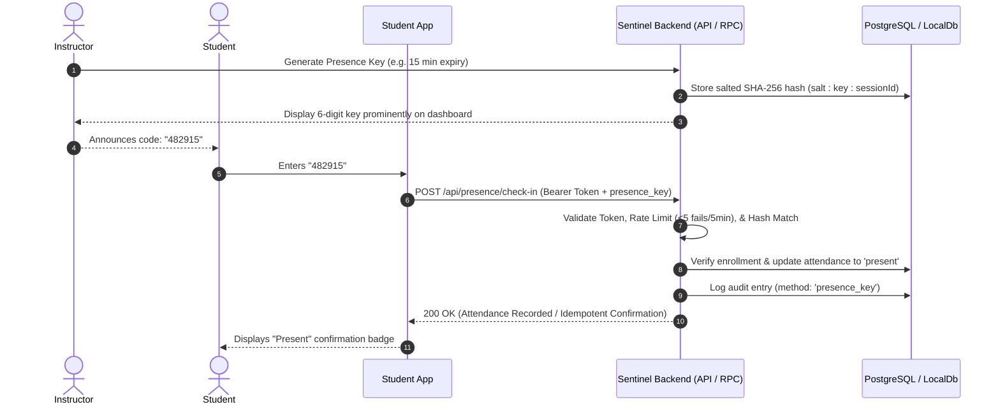

# Sentinel Campus: Student App Integration Guide
## Secure Lecture Presence Keys & Real-Time Check-In API

This document provides complete instructions, schema specifications, and integration examples for connecting the separate **Student App** to the **Sentinel Campus** attendance platform.

---

### Table of Contents
1. [Overview & Architecture](#1-overview--architecture)
2. [Base URL & Connectivity Health Check](#2-base-url--connectivity-health-check)
3. [Authentication & Identity Verification](#3-authentication--identity-verification)
4. [Presence Check-In Endpoint (`POST /api/presence/check-in`)](#4-presence-check-in-endpoint)
5. [Response Schema & HTTP Status Codes](#5-response-schema--http-status-codes)
6. [Idempotency & Safe Status Transitions](#6-idempotency--safe-status-transitions)
7. [Security Guarantees & Anti-Brute-Force Protection](#7-security-guarantees--anti-brute-force-protection)
8. [Code Examples (cURL, Fetch, React Native)](#8-code-examples)
9. [TypeScript Type Definitions](#9-typescript-type-definitions)

---

### 1. Overview & Architecture

Sentinel Campus enables instructors to broadcast dynamic, short-lived **Presence Keys** during active lectures. Students enter this key into their mobile or web application to register attendance in real-time.



---

### 2. Base URL & Connectivity Health Check

#### Production & Staging
- Backend URL: configured via `VITE_API_BASE_URL` or Supabase project URL.

#### Local Development
When the Sentinel Campus dev server is running (`npm run dev`):
- Base URL: `http://localhost:5173`

#### Health Check
Before initiating attendance requests, the student app can verify connectivity:

- **Endpoint:** `GET /api/presence/health`
- **Response:**
  ```json
  {
    "status": "online",
    "service": "Sentinel Campus Student Presence API",
    "version": "1.0.0",
    "timestamp": "2026-10-14T14:00:00.000Z"
  }
  ```

#### Cross-Origin Resource Sharing (CORS)
The presence API is enabled with permissive CORS for student client apps:
- `Access-Control-Allow-Origin: *`
- `Access-Control-Allow-Methods: GET, POST, OPTIONS`
- `Access-Control-Allow-Headers: Content-Type, Authorization, X-Student-Id`

---

### 3. Authentication & Identity Verification

> [!IMPORTANT]
> **Never send a client-supplied `student_id` in the request body as proof of identity.**
> The backend strictly resolves student identity from the authenticated session context.

Every check-in request must include an `Authorization` header containing the student's Bearer token:

```http
Authorization: Bearer <STUDENT_AUTH_TOKEN>
```

- In **Supabase environments**, the Bearer token is the student's Supabase JWT session access token. The backend verifies this token with `auth.uid()`.
- In **Local Development / Mock environments**, pass the student's unique ID or email as the Bearer token (e.g. `Bearer stu-101` or `Bearer alice@campus.edu`). Alternatively, the header `X-Student-Id: <student-id>` is accepted in development mode.

---

### 4. Presence Check-In Endpoint

#### `POST /api/presence/check-in`

Submits the instructor-provided code to mark attendance for the corresponding lecture session.

#### Request Headers
| Header | Value | Description |
| :--- | :--- | :--- |
| `Content-Type` | `application/json` | Standard JSON payload |
| `Authorization` | `Bearer <token>` | Student authentication credentials |

#### Request Body
```json
{
  "presence_key": "482915"
}
```

| Field | Type | Required | Description |
| :--- | :--- | :--- | :--- |
| `presence_key` | `string` | **Yes** | The 6-digit numeric key broadcast by the instructor. Leading/trailing whitespace is automatically trimmed. |

---

### 5. Response Schema & HTTP Status Codes

#### 200 OK — Successful Check-In
Returned when the student is marked Present.

```json
{
  "success": true,
  "already_checked_in": false,
  "code": "CHECKIN_SUCCESS",
  "message": "Attendance recorded successfully.",
  "session": {
    "id": "ses-101",
    "title": "Lecture 14: Balanced Binary Trees & AVL",
    "session_date": "2026-10-14",
    "class_name": "Data Structures & Algorithms"
  },
  "record": {
    "id": "rec-abc12345",
    "status": "present",
    "marked_at": "2026-10-14T10:15:30.120Z",
    "method": "presence_key"
  },
  "student": {
    "id": "stu-101",
    "full_name": "Aiden Vance",
    "roll_number": "CS2024-001"
  }
}
```

#### 200 OK — Idempotent Duplicate Check-In
Returned if the student or network retry submits the key again after having already been marked Present. **No duplicate database records are created.**

```json
{
  "success": true,
  "already_checked_in": true,
  "code": "ALREADY_CHECKED_IN",
  "message": "Attendance has already been recorded for this lecture.",
  "session": {
    "id": "ses-101",
    "title": "Lecture 14: Balanced Binary Trees & AVL",
    "session_date": "2026-10-14",
    "class_name": "Data Structures & Algorithms"
  },
  "record": {
    "id": "rec-abc12345",
    "status": "present",
    "marked_at": "2026-10-14T10:15:30.120Z",
    "method": "presence_key"
  },
  "student": {
    "id": "stu-101",
    "full_name": "Aiden Vance",
    "roll_number": "CS2024-001"
  }
}
```

#### Error Responses

| HTTP Status | Error Code | Description | Example Message |
| :--- | :--- | :--- | :--- |
| **400 Bad Request** | `INVALID_KEY` | Request body missing or `presence_key` is empty. | `"Presence key code is required in request body."` |
| **401 Unauthorized** | `UNAUTHORIZED` | Missing or invalid `Authorization: Bearer <token>`. | `"Authentication required. Missing or invalid Bearer token."` |
| **403 Forbidden** | `NOT_ENROLLED` | Authenticated student is not enrolled in this course/class. | `"You are not enrolled in the class for this lecture session."` |
| **404 Not Found** | `INVALID_OR_EXPIRED_KEY` | Key does not match any active key, or key has expired. | `"Invalid or expired presence key."` |
| **410 Gone** | `SESSION_CLOSED` | Instructor has finalized or closed the attendance session. | `"This attendance session has been finalized or closed."` |
| **429 Too Many Requests** | `RATE_LIMITED` | Student exceeded 5 incorrect attempts within 5 minutes. | `"Too many invalid attempts. Please wait 5 minutes before trying again."` |
| **500 Internal Error** | `INTERNAL_SERVER_ERROR`| Unhandled database or server exception. | `"An unexpected internal error occurred."` |

---

### 6. Idempotency & Safe Status Transitions

1. **Strict Uniqueness:**
   A student can have **at most one attendance record** per lecture session (`UNIQUE(session_id, student_id)` constraint in PostgreSQL).
2. **Network Retries:**
   If a student taps the submit button twice or an unreliable cellular connection retries the request, the second call returns HTTP 200 with `already_checked_in: true` without incrementing counts or modifying the recorded timestamp.
3. **Transition from Unmarked or Absent to Present:**
   If the instructor opened the session and students were initially in the `unmarked` state (or pre-marked `absent` during initial roll call), entering the valid presence key transitions their status to `present` and logs a transition in the audit log (`attendance_audit_logs`) noting `Student self-check-in via presence key`.

---

### 7. Security Guarantees & Anti-Brute-Force Protection

- **Cryptographic Generation:** Keys are uniformly distributed 6-digit integers ($100,000$ to $999,999$) generated via `crypto.getRandomValues()`. Never generated from predictable sequential counters, timestamps, or student IDs.
- **Salted SHA-256 Session-Bound Hashing:** Plaintext keys are never stored in the database. Hashes are computed as:
  $$\text{hash} = \text{SHA-256}(\text{salt} \parallel \text{key} \parallel \text{sessionId})$$
  Because the `sessionId` is bound into the hash, a collision or leaked key cannot be replayed across any other session.
- **Timing Attack Resistance:** Comparisons use constant-time byte comparisons (`timingSafeEqual`).
- **Brute-Force Rate Limiting:** After 5 failed attempts within 5 minutes for a single authenticated student ID, subsequent attempts are blocked with HTTP `429 Too Many Requests`. This prevents automated guessing scripts across the 900,000 possible 6-digit combinations.
- **Immediate Revocation:** If an instructor regenerates or revokes a key, the database status immediately flips to `revoked`, immediately invalidating all pending attempts with that code.

---

### 8. Code Examples

#### cURL
```bash
# 1. Health check
curl -X GET http://localhost:5173/api/presence/health

# 2. Check in with Bearer Token
curl -X POST http://localhost:5173/api/presence/check-in \
  -H "Content-Type: application/json" \
  -H "Authorization: Bearer stu-101" \
  -d '{"presence_key": "482915"}'
```

#### JavaScript / Fetch (Web or React Native)
```typescript
interface CheckInResponse {
  success: boolean;
  already_checked_in?: boolean;
  code?: string;
  message: string;
  session?: {
    id: string;
    title: string;
    session_date: string;
    class_name?: string;
  };
  record?: {
    id: string;
    status: 'present';
    marked_at: string;
    method: 'presence_key';
  };
}

async function submitPresenceKey(
  authToken: string,
  keyCode: string
): Promise<CheckInResponse> {
  const response = await fetch('http://localhost:5173/api/presence/check-in', {
    method: 'POST',
    headers: {
      'Content-Type': 'application/json',
      'Authorization': `Bearer ${authToken}`,
    },
    body: JSON.stringify({
      presence_key: keyCode.trim(),
    }),
  });

  const data: CheckInResponse = await response.json();

  if (!response.ok) {
    throw new Error(data.message || `Check-in failed with HTTP ${response.status}`);
  }

  return data;
}
```

---

### 9. TypeScript Type Definitions

Teammates building the student app can copy these TypeScript types directly:

```typescript
export interface CheckInRequest {
  presence_key: string;
}

export interface CheckInSessionInfo {
  id: string;
  title: string;
  session_date: string;
  class_name?: string;
}

export interface CheckInRecordInfo {
  id: string;
  status: 'present';
  marked_at: string;
  method: 'presence_key';
}

export interface CheckInStudentInfo {
  id: string;
  full_name: string;
  roll_number: string;
}

export interface CheckInResult {
  success: boolean;
  already_checked_in?: boolean;
  code?:
    | 'CHECKIN_SUCCESS'
    | 'ALREADY_CHECKED_IN'
    | 'INVALID_KEY'
    | 'INVALID_OR_EXPIRED_KEY'
    | 'NOT_ENROLLED'
    | 'SESSION_CLOSED'
    | 'RATE_LIMITED'
    | 'UNAUTHENTICATED'
    | 'INTERNAL_SERVER_ERROR';
  message: string;
  session?: CheckInSessionInfo;
  record?: CheckInRecordInfo;
  student?: CheckInStudentInfo;
}
```
